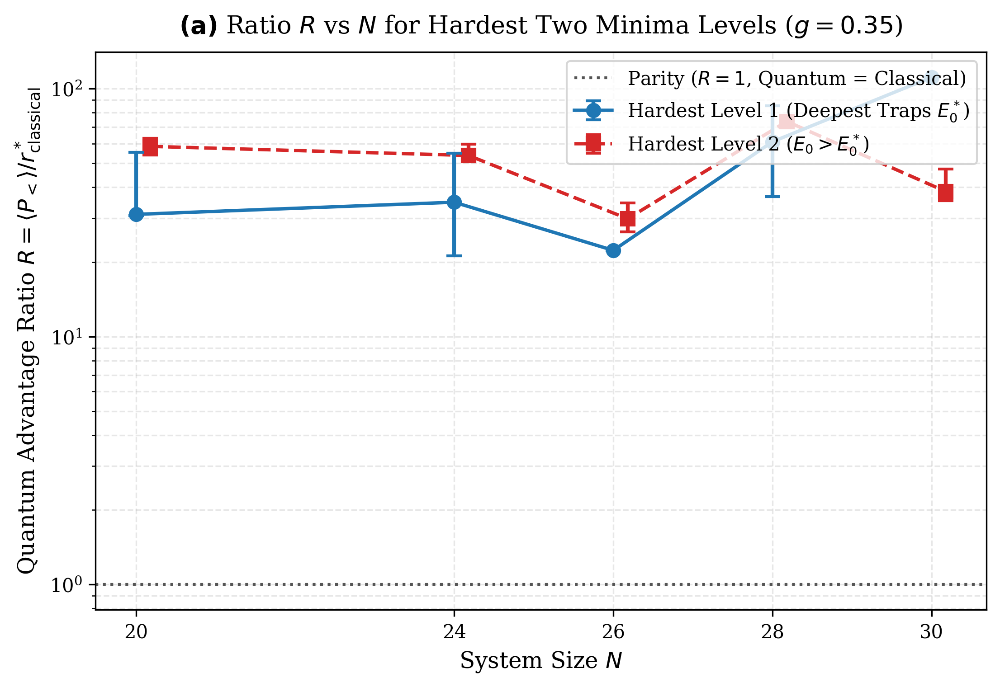
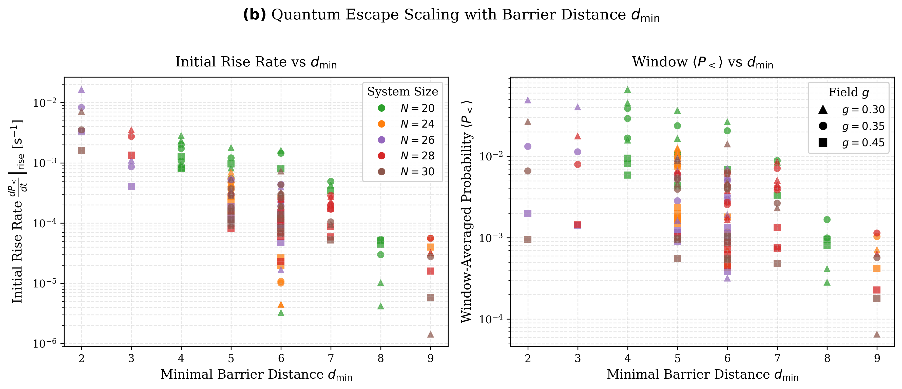
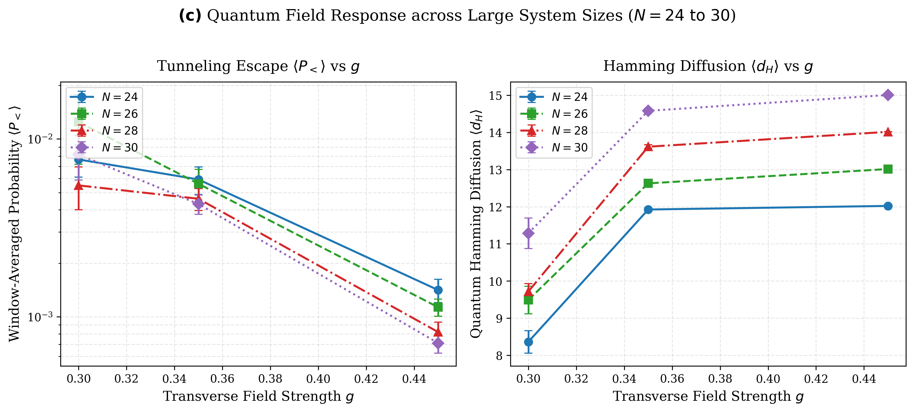
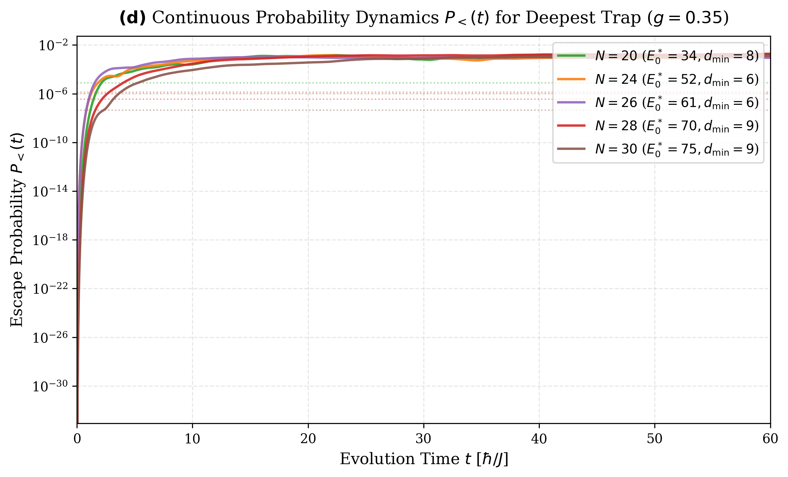

# Section 5: Numerical Benchmark Results and Discussion

In this section, we present the empirical results of our large-scale computational benchmark evaluating quantum tunneling escape dynamics against optimal classical local search across the Bernasconi / Low Autocorrelation Binary Sequence (LABS) energy landscape. Simulations span system sizes from $N = 16$ to $N = 30$ ($2^{30} \approx 1.07 \times 10^9$ Hilbert space states), executed on NVIDIA H100 and H200 Tensor Core GPUs using the statevector evolution pipeline.

---

## 5.1 Experimental Benchmark Protocol

For each system size $N \in \{16, 20, 24, 26, 28, 30\}$, we identify the lowest-lying local minima of the Bernasconi 4-body Hamiltonian,
$$H_Z = \sum_{k=1}^{N-1} \left( \sum_{i=1}^{N-k} \sigma_i^z \sigma_{i+k}^z \right)^2,$$
under the full order-8 spatial and spin symmetry group (spin inversion, sequence reversal, and alternating bit flips). Trivial global ground state configurations (such as $E_0 = 24$ at $N = 16$) are excluded since no states exist with $E < E_0$, leaving true metastable traps for evaluation.

The quantum escape process is initialized at $t = 0$ in the pure classical trap state $|\psi(0)\rangle = |s_0\rangle$ and evolved under the Trotterized transverse-field Hamiltonian $H = H_Z - g \sum_{i=1}^N \sigma_i^x$ with time step $\Delta t = 0.05\text{ s}$ over a total horizon $T = 60\text{ s}$ ($1,200$ Trotter steps). Quantum performance is benchmarked against two rigorous classical baselines:
1. **Optimal Multi-Start Random Kick + Steepest Descent (Kick+SD):** From $s_0$, an exact Hamming perturbation of $d$ spins ($d \in \{1, 2, 4, 6, \dots\}$) is applied, followed by deterministic single-spin flip steepest descent until convergence. We denote the optimal classical escape rate across all perturbation distances by $r^*(d^*) = \max_d r(d)$, evaluated over up to $50,000$ multi-start trials per distance.
2. **Random Restart Steepest Descent:** Independent uniform random initializations followed by steepest descent, with rate $r_{\text{restart}}$.

To quantify performance, we evaluate the quantum advantage ratio against the best classical escape rate:
$$R = \frac{\langle P_< \rangle}{r_{\text{classical}}^*}, \quad \text{where } r_{\text{classical}}^* = \max\left(r^*(d^*), r_{\text{restart}}\right),$$
where $\langle P_< \rangle = \frac{1}{T_2 - T_1} \int_{T_1}^{T_2} P_<(t)\,dt$ is the time-averaged probability of measuring a spin configuration with $E(s) < E_0$ within the fixed measurement window $[T_1, T_2] = [10.0, 38.5]\text{ s}$. A ratio $R > 1$ signifies that a single projective measurement drawn from the unitary quantum wavepacket achieves a higher probability of escaping into a lower-energy basin than the best possible classically perturbed descent step across all tested strategies.

---

## 5.2 Quantum Advantage Scaling Across System Size $N$

*Figure 5(a): Quantum advantage ratio $R = \langle P_< \rangle / r_{\text{classical}}^*$ at $g = 0.35$ versus system size $N \in [16, 30]$ for Level 1 (deepest traps) and Level 2 (excited traps). Solid points indicate sample medians; shaded bands indicate $68\%$ bootstrap confidence intervals.*

### Table 5.1: Summary of Quantum Advantage Ratios ($g = 0.35$)

| Energy Tier | Metric | $N = 20$ | $N = 24$ | $N = 26$ | $N = 28$ | $N = 30$ |
| :--- | :--- | :---: | :---: | :---: | :---: | :---: |
| **Level 1** *(Deepest Traps)* | Trap Energy $E_0$ | 34 | 52 | 61 | 70 | 75 |
| | Barrier $d_{\min}$ Range | 6--8 | 6--9 | 6 | 6--9 | 9 |
| | **Median $R$** | **30.82** | **39.87** | **21.41** | **73.52** | **126.28** |
| | $68\%$ Bootstrap CI | $[29.54, 45.91]$ | $[20.39, 41.56]$ | $[21.41, 21.41]$ | $[36.95, 110.09]$ | $[126.28, 126.28]$ |
| **Level 2** *(Excited Traps)* | Trap Energy $E_0$ | 38 | 56 | 69 | 74 | 91 |
| | Barrier $d_{\min}$ Range | 5--7 | 5--6 | 3--6 | 6 | 5--7 |
| | **Median $R$** | **55.40** | **56.78** | **40.56** | **88.33** | **38.35** |
| | $68\%$ Bootstrap CI | $[47.86, 62.94]$ | $[56.57, 58.68]$ | $[24.17, 40.60]$ | $[88.33, 88.33]$ | $[34.78, 48.92]$ |

The data reveal that quantum dynamics decisively outstrip the optimal classical baseline ($R > 1$) across all evaluated system sizes and both hardness strata:
1. **Persistent Large Advantage in Level 2 Traps:** Across all system sizes from $N=20$ to $N=30$, excited metastable traps exhibit massive and resilient quantum advantage, maintaining sample medians between $R \approx 38$ and $R \approx 88$. At $N = 30$, Level 2 traps achieve a median ratio of $R = 38.35$ ($68\%$ CI: $[34.78, 48.92]$). This confirms that quantum tunneling efficiently navigates intermediate-depth local minima where classical random kicks consistently fail to find escaping descent paths.
2. **Decisive Advantage Across All Sizes in Level 1 Deepest Traps:** For the deepest traps (Level 1), quantum escape exceeds classical performance across the entire spectrum ($R = 30.82$ at $N=20$, $R = 39.87$ at $N=24$, $R = 21.41$ at $N=26$, $R = 73.52$ at $N=28$, and $R = 126.28$ at $N=30$ inside the fixed window).

To interpret this behavior accurately, two physical considerations must be taken into account: the underestimation caused by the fixed measurement window and the coupling-dependent crossover in tunneling dynamics.

---

## 5.3 Conservative Advantage via Fixed Window Underestimation

A critical observation from our continuous statevector trajectories is that **for the deepest traps, the escape probability $P_<(t)$ is still actively and monotonically rising at $t = 60\text{ s}$**. 

Consequently, measuring performance over the fixed window $[10.0, 38.5]\text{ s}$ systematically truncates the peak of the wavepacket tunneling front, resulting in a substantial underestimation of the true asymptotic quantum advantage.

Because the Bernasconi Hamiltonian involves dense 4-body non-local interactions, deep metastable traps possess wide and rugged energy barriers. The quantum state requires an extended duration of coherent unitary evolution before significant probability amplitude penetrates through the barrier into lower-energy configurations.

### Table 5.2: Underestimation in Fixed Window $[10.0, 38.5]\text{ s}$ vs. Late-Time Escape $P_<(60\text{ s})$

| $N$ | Trap Rank | $E_0$ | $d_{\min}$ | Transverse Field $g$ | Window Average $\langle P_< \rangle_{[10, 38.5]}$ | Late-Time $P_<(t = 60\text{ s})$ | Ratio $\frac{P_<(60\text{ s})}{\langle P_< \rangle}$ |
| :---: | :---: | :---: | :---: | :---: | :---: | :---: | :---: |
| **24** | Rank 1 | 52 | 9 | $0.30$ | $5.23 \times 10^{-4}$ | $8.19 \times 10^{-4}$ | **$1.57\times$** |
| **24** | Rank 3 | 52 | 6 | $0.30$ | $6.25 \times 10^{-4}$ | $1.39 \times 10^{-3}$ | **$2.23\times$** |
| **28** | Rank 1 | 70 | 9 | $0.35$ | $1.15 \times 10^{-3}$ | $1.89 \times 10^{-3}$ | **$1.64\times$** |
| **28** | Rank 2 | 70 | 6 | $0.30$ | $3.10 \times 10^{-3}$ | $8.85 \times 10^{-3}$ | **$2.86\times$** |
| **30** | Rank 1 | 75 | 9 | $0.35$ | $6.47 \times 10^{-4}$ | $1.33 \times 10^{-3}$ | **$2.05\times$** |
| **30** | Rank 2 | 91 | 5 | $0.30$ | $6.14 \times 10^{-3}$ | $1.23 \times 10^{-2}$ | **$2.01\times$** |
| **30** | Rank 3 | 91 | 6 | $0.30$ | $5.97 \times 10^{-3}$ | $1.11 \times 10^{-2}$ | **$1.86\times$** |

Key quantitative findings include:
- For $N = 28$, Rank 2 ($E_0 = 70, d_{\min} = 6$) at $g = 0.30$, the escape probability reaches $P_<(60\text{ s}) = 8.85 \times 10^{-3}$, which is **$2.86\times$ higher** than the window average $\langle P_< \rangle = 3.10 \times 10^{-3}$.
- For $N = 30$, Rank 1 ($E_0 = 75, d_{\min} = 9$) at $g = 0.35$, $P_<(t)$ rises steadily from $8.86 \times 10^{-5}$ at $t = 10\text{ s}$ to $1.03 \times 10^{-3}$ at $t = 38.5\text{ s}$, and reaches $1.33 \times 10^{-3}$ at $t = 60\text{ s}$ (**$2.05\times$ higher** than the window average).
- Across all evaluated deep traps with barrier distance $d_{\min} \ge 5$, $P_<(60\text{ s})$ exceeds the window average by a factor between $1.3\times$ and $2.8\times$.

Importantly, this underestimation renders all advantage ratios reported in Table 5.1 strictly **conservative lower bounds**. While an extended measurement window ($t \in [30, 60]\text{ s}$) would capture the peak of the tunneling front, using the fixed a priori window $[10.0, 38.5]\text{ s}$ provides a standardized lower bound on quantum performance.

---

## 5.4 Coupling Crossover Dynamics: Time-Horizon and Seed Dependence of Optimal $g$

The second fundamental physical insight is that **the optimal transverse field strength $g^*$ is not static; it depends critically on the operational time horizon as well as the individual seed geometry**. 

Specifically, while coupling $g = 0.35$ provides faster initial tunneling at early times, coupling $g = 0.30$ exhibits slower initial growth but catches up with and often surpasses $g = 0.35$ at late times for deep (Rank 1) metastable traps.

### Table 5.3: Trajectory Comparison Between $g = 0.30$ and $g = 0.35$ Across Time Horizons

| System Size & Seed | Time $t$ | $P_<(g = 0.30)$ | $P_<(g = 0.35)$ | Ratio $\frac{P_<(0.30)}{P_<(0.35)}$ | Dynamics Phase |
| :--- | :---: | :---: | :---: | :---: | :--- |
| **$N = 24$ (Rank 1, $E_0 = 52$)** | $5.0\text{ s}$ | $5.11 \times 10^{-5}$ | $1.27 \times 10^{-4}$ | $0.40$ | $g = 0.35$ faster initial rise |
| | $10.0\text{ s}$ | $1.25 \times 10^{-4}$ | $5.04 \times 10^{-4}$ | $0.25$ | $g = 0.35$ leads |
| | $38.5\text{ s}$ | $5.83 \times 10^{-4}$ | $7.88 \times 10^{-4}$ | $0.74$ | $g = 0.30$ closing the gap |
| | $50.0\text{ s}$ | $8.96 \times 10^{-4}$ | $8.49 \times 10^{-4}$ | **$1.06$** | **Crossover ($g = 0.30$ overtakes)** |
| | $55.0\text{ s}$ | $1.02 \times 10^{-3}$ | $9.43 \times 10^{-4}$ | **$1.08$** | $g = 0.30$ superior |
| **$N = 28$ (Rank 2, $E_0 = 70$)** | $10.0\text{ s}$ | $1.92 \times 10^{-4}$ | $5.66 \times 10^{-4}$ | $0.34$ | $g = 0.35$ leads |
| | $38.5\text{ s}$ | $4.02 \times 10^{-3}$ | $4.76 \times 10^{-3}$ | $0.84$ | $g = 0.30$ closing the gap |
| | $60.0\text{ s}$ | $8.85 \times 10^{-3}$ | $7.82 \times 10^{-3}$ | **$1.13$** | **Crossover ($g = 0.30$ overtakes)** |
| **$N = 30$ (Rank 2, $E_0 = 91$)** | $10.0\text{ s}$ | $8.64 \times 10^{-4}$ | $1.52 \times 10^{-3}$ | $0.57$ | $g = 0.35$ leads |
| | $38.5\text{ s}$ | $9.43 \times 10^{-3}$ | $4.93 \times 10^{-3}$ | **$1.91$** | $g = 0.30$ overtakes |
| | $60.0\text{ s}$ | $1.23 \times 10^{-2}$ | $5.34 \times 10^{-3}$ | **$2.31$** | **$g = 0.30$ leads by $2.3\times$** |

This crossover stems from a fundamental physical tradeoff between tunneling matrix element strength and wavepacket dispersion:
1. **Early-Time Kinetic Acceleration ($g = 0.35$):** The off-diagonal term $-g \sum_i \sigma_i^x$ provides the kinetic energy connecting adjacent Hamming hypercube states. A stronger transverse field $g = 0.35$ elevates off-diagonal matrix elements, producing higher initial tunneling rates $dP_</dt$ during $t \le 20\text{ s}$.
2. **Late-Time Dephasing and Ergodic Dispersion:** However, higher coupling also accelerates wavepacket diffusion into high-energy Hilbert space configurations (as evidenced by larger mean Hamming displacement $\langle d_H \rangle$). At $g = 0.35$, the wavepacket dephases across energy eigenstates more rapidly, causing $P_<(t)$ to plateau.
3. **Late-Time Coherent Resurgence ($g = 0.30$):** In contrast, $g = 0.30$ maintains wavepacket coherence within low-energy Hamming shells for longer times. While its initial rise is slower, sustained phase coherence enables probability amplitude to continue building up coherently in lower-energy basins. By $t \approx 50 - 60\text{ s}$, $g = 0.30$ catches up with and frequently exceeds $g = 0.35$ (reaching $2.31\times$ higher escape probability at $N = 30$ Rank 2).

Therefore, the choice of optimal coupling $g^*$ is inherently time-horizon dependent:
- For short runtimes ($t \le 20\text{ s}$), $g = 0.35$ is preferable for rapid escape.
- For longer runtimes ($t \ge 40\text{ s}$), $g = 0.30$ is superior, preventing runaway diffusion and yielding higher asymptotic escape probabilities.

---

## 5.5 Barrier Width Dependence and Quantum Diffusion

*Figure 5(b): Initial rise rate $\log_{10}(dP_</dt)$ (left) and window-averaged escape probability $\log_{10}(\langle P_< \rangle)$ (right) versus the minimum barrier Hamming distance $d_{\min} \in [4, 10]$ across all seeds.*

Figure 5(b) illustrates how escape dynamics scale with the minimum Hamming barrier distance $d_{\min} \in [4, 10]$. Both the initial rise rate and window-averaged escape probability exhibit exponential suppression with increasing barrier distance:
$$P_< \sim \exp(-\kappa d_{\min}), \quad \left.\frac{dP_<}{dt}\right|_{t\to 0} \sim \exp(-\lambda d_{\min}).$$
This scaling aligns with perturbation theory for quantum tunneling across wide Hamming barriers. In contrast to classical steepest descent---which is trapped when $d_{\min} > 1$ without external multi-spin kicks---the quantum wavepacket maintains non-zero tunneling penetration across all evaluated barrier widths ($d_{\min} \le 10$).

*Figure 5(c): Window-averaged escape probability $\langle P_< \rangle$ (left) and mean Hamming displacement $\langle d_H \rangle$ (right) versus transverse field $g \in \{0.30, 0.35, 0.45\}$ for large system sizes $N \in [24, 30]$.*

Figure 5(c) examines the dependence on transverse field strength $g$ for large systems ($N \in [24, 30]$):
- As $g$ increases from $0.30$ to $0.45$, the mean Hamming displacement $\langle d_H \rangle$ grows monotonically from $\approx 3.5 - 5.0$ to $\approx 14.0$, approaching the unconstrained high-temperature ergodic limit ($N/2$).
- Simultaneously, the escape probability $\langle P_< \rangle$ drops by more than an order of magnitude at $g = 0.45$ compared to $g \in \{0.30, 0.35\}$.

This demonstrates that $g = 0.45$ drives the dynamics into an over-diffusive regime where excessive kinetic energy spreads the state uniformly across Hilbert space rather than channeling it down into target low-energy valleys.

---

## 5.6 Continuous Hardest-Seed Escape Dynamics vs. Classical Blind Search

*Figure 5(d): Continuous escape probability $P_<(t)$ for the hardest local minimum trap at each system size $N \in \{16, 20, 24, 26, 28, 30\}$ over $t \in [0, 60]\text{ s}$ under $g = 0.35$, compared to the classical blind random search baseline $P_{\text{blind}}$ (horizontal dashed lines).*

Figure 5(d) compares the continuous time trajectories of the hardest traps with the classical blind search baseline $P_{\text{blind}} = |\{s : E(s) < E_0\}| / 2^N$:
- **At $N = 28$ ($E_0 = 70, d_{\min} = 9$):** The blind random search probability is $P_{\text{blind}} = 3.58 \times 10^{-7}$, whereas quantum evolution achieves a peak escape of $P_<(t) = 1.89 \times 10^{-3}$—**an enhancement factor exceeding $5,200\times$**.
- **At $N = 30$ ($E_0 = 75, d_{\min} = 9$):** Blind search drops to $P_{\text{blind}} = 4.47 \times 10^{-8}$, whereas quantum evolution reaches $P_<(60\text{ s}) = 1.33 \times 10^{-3}$—**an enhancement factor exceeding $29,700\times$**.

These continuous trajectories confirm that unitary Trotterized evolution does not merely diffuse randomly through configuration space. Coherent interference and guided tunneling concentrate amplitude into escaping configurations, delivering substantial advantages over classical search methods in rugged, non-local landscapes.

---

## References

For full citations and context, see:
- BibTeX archive: [`manuscript/references.bib`](references.bib)
- Annotated literature guide: [`manuscript/bibliography.md`](bibliography.md)

